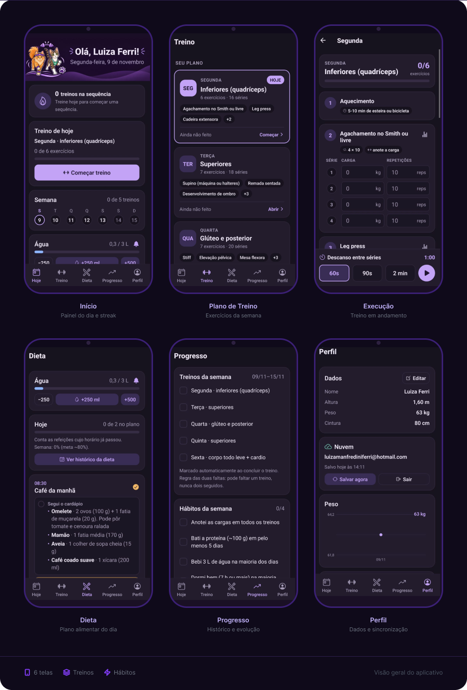

<h1 align="center">MeowFit 🐾</h1>

<p align="center">
  Treino, cargas, dieta, água e medidas num app só: pessoal, leve e que funciona offline.
</p>

<p align="center">
  
  
  
  
  
  
</p>

---

## ✨ O que ele faz



| | |
|---|---|
| 🏠 **Hoje** | Treino do dia, sequência de treinos (o foguinho 🔥), semana clicável, água e refeições |
| 🏋️ **Treino** | Plano da semana ou em rodízio, séries com carga e repetições, cronômetro de descanso e evolução de cada exercício |
| 🥗 **Dieta** | Cardápio do dia com opções, refeições marcadas como "no plano" e histórico |
| 📈 **Progresso** | Treinos e hábitos da semana, peso, cintura e IMC em gráficos |
| 👤 **Perfil** | Dados, plano, backup em arquivo, nuvem e tema (Lilás ou Escuro) |
| 📱 **Extras** | Widgets na tela inicial do Android, lembretes de água e de treino, importação do cardápio da nutricionista colando o texto |

## 🧭 Decisões de arquitetura

**1. Local-first: o celular é a fonte da verdade.**
Todos os dados ficam num SQLite no aparelho (`expo-sqlite`). O app abre na hora, funciona sem internet e não depende de servidor para nada do dia a dia. Na web o mesmo SQLite roda em WebAssembly, guardado no OPFS do navegador.

**2. A nuvem é backup por pessoa, não sincronização em tempo real.**
O [Supabase](https://supabase.com) guarda **uma linha por conta**, com o backup completo em JSON.
- O aparelho envia sozinho alguns segundos depois de cada mudança, e só quando os dados mudaram (hash do backup).
- Os dados descem da nuvem só no login ou quando a pessoa escolhe.
- **Proteção contra conflito:** o envio é condicional (`update … where updated_at = <última versão que este aparelho viu>`). Se outro aparelho salvou depois, nada é sobrescrito e o app pergunta qual versão manter.

Assim o app continua simples e offline, e trocar de celular deixa de ser um problema.

**3. Segurança sem backend próprio.**
- Login **sem senha**: um código chega por e-mail (OTP do Supabase Auth).
- O app só tem a chave *publishable*. Quem protege os dados é o **Row Level Security**: cada conta só lê e escreve a própria linha (`auth.uid() = user_id`), e o acesso anônimo é revogado. O SQL está em [`supabase/schema.sql`](supabase/schema.sql).
- Chave secreta, senha do banco e SMTP nunca entram no código.

**4. Um app, duas plataformas.**
- **Android:** APK compilado na nuvem com EAS Build e instalado direto, sem Play Store.
- **iPhone:** PWA (Expo Router com `web.output: "server"`, hospedado no EAS Hosting) e "Adicionar à Tela de Início" no Safari, sem conta paga da Apple.
- O código é o mesmo. O que só existe no Android (widgets, notificações) fica atrás de flags (`widgetsAvailable`, `notificationsAvailable`).

**5. Regras de negócio em funções puras e testadas.**
Sequência de treinos, parser do cardápio, backup, conflitos da nuvem, medidas e horários dos lembretes ficam em `src/lib/`, sem React. Os testes usam SQLite de verdade (`node:sqlite`) para as consultas.

**6. Tudo guardado por data.**
Água, refeições e séries são gravadas por dia (`yyyy-MM-dd`). Cada dia começa do zero e o histórico fica completo. O app recalcula ao voltar para a tela e à meia-noite.

**7. Regras inspiradas no Duolingo.**
O treino só pode ser marcado no próprio dia, e dias passados abrem só para ver. A sequência considera os dias que a pessoa escolheu treinar, perdoa uma falta e conta a caminhada nos dias de descanso.

**8. Lembretes que chegam de verdade.**
As notificações locais são agendadas como **alarmes exatos** (`USE_EXACT_ALARM`). Os alarmes inexatos são adiados ou descartados por celulares com economia de bateria agressiva, como os da Xiaomi.

<details>
<summary><b>Stack completa</b></summary>

| Camada | Biblioteca |
|---|---|
| Framework | Expo SDK 58, React Native 0.88, React 19, TypeScript |
| Navegação | Expo Router (rotas por arquivo em `src/app`) |
| Banco | expo-sqlite (Android e web/OPFS) |
| Estado | zustand |
| Nuvem | Supabase (Auth por código + Postgres com RLS) |
| Datas | date-fns (pt-BR, semana começando na segunda) |
| Gráficos | react-native-svg (componente próprio) |
| Widgets | react-native-android-widget |
| Notificações | expo-notifications (locais) |
| Testes | jest + jest-expo |
| Build e deploy | EAS Build (APK) e EAS Hosting (web) |

</details>

<details>
<summary><b>Estrutura de pastas</b></summary>

```
src/
  app/          rotas (cada arquivo é uma tela): (tabs), workout/[day], exercise/[name], cloud-login…
  components/   UI reutilizável, temas, cards e editores
  db/           schema, migrações e todas as consultas SQL
  lib/          lógica pura: sequência, parser, backup, nuvem, lembretes, datas
  store/        estado global (zustand) e hooks de dados
  widgets/      widgets do Android
supabase/       SQL da tabela e modelo do e-mail de login
docs/           documentação técnica completa
```

</details>

## 🚀 Como rodar

Requisitos: **Node 22+** (os testes usam o `node:sqlite`) e npm.

```bash
npm install
```

### No celular, com o Expo Go (mais rápido)

```bash
npx expo start
```

Instale o **Expo Go** pela Play Store e leia o QR code, com o celular e o PC na mesma rede Wi-Fi. As mudanças aparecem na hora.

> No Expo Go não há widgets, e as notificações agendadas podem não funcionar bem. Para testar essas partes, use o development build abaixo.

### Development build (widgets e notificações)

```bash
npx eas-cli@latest build -p android --profile development
npx expo start --dev-client
```

Instale o APK gerado uma vez. Depois disso, ele conecta no PC e atualiza na hora, como no Expo Go.

### Na web

```bash
npx expo start --web
```

Abre em `http://localhost:8081`. O banco fica no navegador (OPFS), que só permite **uma aba aberta por vez**.

Para testar a versão de produção:

```bash
npx expo export -p web
npx expo serve
```

## 📦 Publicar

### APK para Android

```bash
npx eas-cli@latest login
npx eas-cli@latest build -p android --profile preview
```

Antes de cada build, aumente o `version` no `app.json`. No fim, o EAS mostra um link e um QR code: é só baixar o `.apk` no celular e instalar por cima, sem perder os dados.

### Web / iPhone (PWA)

```bash
npx expo export -p web
npx eas-cli@latest deploy --prod
```

No iPhone, abra o endereço no **Safari** → **Compartilhar** → **Adicionar à Tela de Início**. Funciona tudo, menos widgets e notificações.

### Nuvem (opcional, para quem fizer um fork)

1. Crie um projeto no Supabase e rode [`supabase/schema.sql`](supabase/schema.sql) no SQL Editor.
2. Em **Authentication → Email**, configure um SMTP próprio e use [`supabase/email-code.html`](supabase/email-code.html) nos modelos "Magic Link" e "Confirm signup" (os dois com `{{ .Token }}`).
3. Troque a URL e a chave *publishable* em [`src/lib/supabase.ts`](src/lib/supabase.ts).

## 📝 Importar treino e dieta

Dá para montar o plano item por item ou colar um texto. O formato aceita o cardápio da nutricionista como ele vem, com horários e quantidades.

<details>
<summary><b>Exemplo de treino</b></summary>

```
Segunda: inferiores
Aquecimento: 5-10 min de esteira
Leg press: 3 x 12, carga ___ kg
Prancha: 3 x 30 s

Treino B: superiores          ← treinos em rodízio também funcionam
Supino: 4 x 10, carga ___ kg

Hábitos:
Dormi 7 h ou mais
```

</details>

<details>
<summary><b>Exemplo de dieta</b></summary>

```
Café da manhã: 2 ovos e pão integral | iogurte com aveia
Almoço: frango e arroz | peixe e batata

kcal: 1600-1750
proteína: 100-110
água: 2.5

Regras:
Proteína em toda refeição
```

</details>

## 🧪 Verificação

```bash
npm test             # regras, parser, consultas SQL e backup
npm run typecheck
npm run lint
npx expo-doctor
```

## 📚 Documentação

A documentação técnica completa está em [docs/DOCUMENTATION.md](docs/DOCUMENTATION.md). Ela cobre arquitetura, banco, formato de importação, backup, regras de negócio, widgets, versão web, nuvem e como estender o app.

<p align="center">Feito com 💜 e dois gatos de faixa na cabeça.</p>
